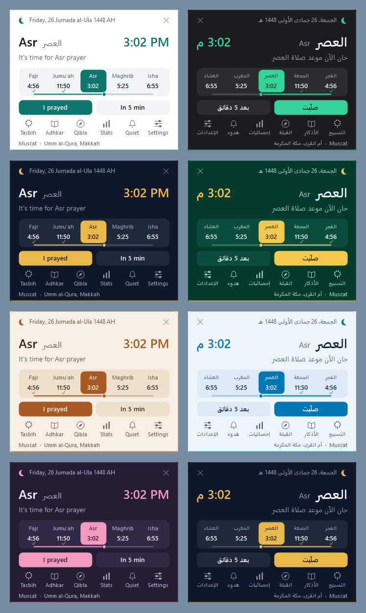
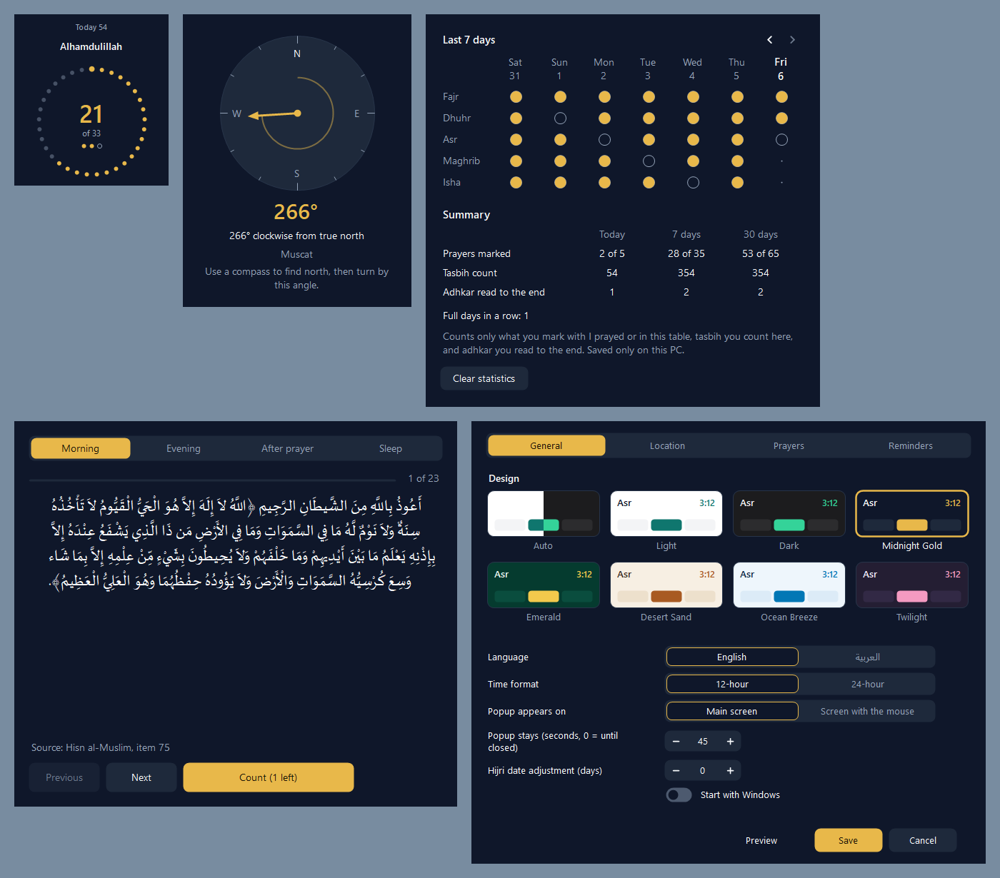

# Prayer Times Popup · أوقات الصلاة

A tiny Windows tray app that shows a clean popup in the top-right corner of your screen at each prayer time, based on your location. It also has a tasbih counter, adhkar reminders, the Qibla direction and personal statistics, in English and Arabic.





## Download

1. Download [`PrayerTimes.exe`](https://github.com/Eng-Somar/prayer-times-popup/releases/latest/download/PrayerTimes.exe) from the [latest release](https://github.com/Eng-Somar/prayer-times-popup/releases/latest).
2. Double-click it. A crescent icon appears in the system tray (check under the **^** arrow on the taskbar).

There is no installer. The app needs Windows 10 or 11, which already include the .NET Framework it runs on.

> The exe isn't code-signed, so Windows SmartScreen may warn you the first time. Choose **More info → Run anyway**, or [build it yourself](#build-from-source).

## Features

**Reminders**

- A popup appears before each prayer (10 minutes by default) and again at the prayer time, without taking focus from what you're typing.
- **I prayed** and **In 5 min** buttons, plus an optional iqama countdown for each prayer.
- Every option is one click away on the card: tasbih, adhkar, Qibla, statistics, quiet for 1 hour, and settings.
- The card is live: hover a prayer to see how far away it is, click a passed prayer to mark it, and a line shows where today is between prayers.
- Reminders wait while a full-screen app or presentation is running, and you can turn on **Do not disturb** from the tray for 1 or 3 hours.
- Turn the reminder and sound on or off for each prayer, and adjust each time by minutes to match your official timetable.

**Worship**

- **Tasbih ring:** a small floating misbaha that doesn't take focus. Each tap fills a bead, and finishing a round sends a wave around the ring. Use the 33, 33, 34 sequence or a free count. `Ctrl+Alt+Shift+Space` counts while it's open, right-click it for more options, and press and hold its reset button to start over.
- **Adhkar:** morning, evening, after-prayer and sleep adhkar in a reader that counts the repetitions. Click the text or the button to count. Reminders are off by default. The text is shown in Arabic only.
- **Ramadan:** an imsak reminder and an iftar countdown.
- **Recommended fasts:** an optional reminder the evening before Mondays, Thursdays and the White Days. It never suggests a day on which fasting is forbidden.
- **Qibla:** the angle from true north for your location. A PC has no compass, so you'll need one to find north.
- **Statistics:** a weekly table of the prayers you marked, which you can correct and page back through, plus totals for today, 7 days and 30 days. It only counts what you record, and you can clear it at any time.

**Lightweight and private**

- A small exe that uses almost no CPU. Prayer times are calculated on your PC.
- **7 designs** (Light, Dark, Midnight Gold, Emerald, Desert Sand, Ocean Breeze, Twilight), plus *Auto*, which follows the Windows light/dark setting. Every window uses your design, and choosing one in Settings previews it straight away.
- Animation only runs while something is moving, and follows **Show animations in Windows** in the Windows accessibility settings.
- **English and العربية**, with full right-to-left layout and the Hijri date, which you can adjust by up to 2 days.

## Usage

| Action | What happens |
|---|---|
| Left-click the tray icon | Shows the next prayer; click again to close it |
| Right-click the tray icon | Today's times, tasbih, adhkar, Qibla, statistics, Do not disturb, Settings, updates, Exit |
| Open the exe again while it's running | Opens Settings |
| Hover over a popup | Keeps it open |
| Click the X, or drag the popup to the right | Closes it |

**Custom adhan:** put a file named `adhan.wav` next to `PrayerTimes.exe` and it plays at prayer time. Otherwise a soft system chime plays.

Settings are stored in `%APPDATA%\PrayerTimesPopup\`. Unexpected errors are written to `errors.log` in the same folder.

## Accuracy

Times are calculated astronomically, so they can differ by a few minutes from your local mosque or official timetable. Please follow your local authority where they differ, and use the per-prayer adjustment in Settings to match it.

- **Other methods:** against [api.aladhan.com](https://aladhan.com/prayer-times-api) for test cities, Fajr, Sunrise, Dhuhr, Maghrib and Isha match to the minute, except for a 1-minute Fajr difference at high latitude. Asr can differ from that service by a few minutes.
- **Independent check:** the tests include a second solar calculation that shares no code with the app. Sunrise, Dhuhr, Asr (Standard and Hanafi) and Maghrib agree with it within 1 minute for 8 cities in every month of 2026.
- **UAE method:** fixed adjustments were fitted to a [Dubai timetable](https://emirates247.com/prayer-time) based on IACAD data for November 2026, and the result is within 1 minute for that month. Other months and emirates haven't been checked.
- **Manual location:** times are always shown on your PC's clock. For a city in another time zone, change the Windows time zone too.

Far north, some times don't occur at certain times of year. The app shows a dash for those and doesn't remind you.

## Location and privacy

In auto-detect mode, the app sends your IP address to a public geolocation service to find your city: [ipwho.is](https://ipwho.is), with [ipapi.co](https://ipapi.co) and [ip-api.com](https://ip-api.com) (unencrypted HTTP) as fallbacks. If Windows Location is turned on, the app uses it for more precise coordinates.

If the detected location is more than 100 km away, for example because of a VPN, your prayer times don't change. The app asks you first.

Choose **Manual** in Settings to skip these lookups. **Check for updates** only contacts GitHub when you click it. Your location and statistics are only saved on your PC.

## Build from source

Run these on Windows. They use the C# compiler included with Windows, so no SDK is needed:

```powershell
powershell -ExecutionPolicy Bypass -File build.ps1
```

```powershell
powershell -ExecutionPolicy Bypass -File test.ps1
```

The app is built to `dist\PrayerTimes.exe`. `tools\build-adhkar-data.ps1` regenerates `data\adhkar.tsv` from the source, so the text is never retyped by hand.

See [CONTRIBUTING.md](CONTRIBUTING.md) to help and [SECURITY.md](SECURITY.md) to report a vulnerability.

## Credits and license

- Prayer time calculation is a C# port of [PrayTimes.js](http://praytimes.org), Copyright (C) 2007-2017 PrayTimes.org, developed by Hamid Zarrabi-Zadeh and licensed under the GNU LGPL v3.0.
- Adhkar text comes from [Hisn al-Muslim](https://hisnmuslim.com).

This project is licensed under the GNU LGPL v3.0: see [LICENSE](LICENSE) and [COPYING](COPYING) (the GNU GPL v3.0 text it builds on).

---

## بالعربية

تطبيق صغير لنظام ويندوز يعمل من شريط المهام، ويعرض نافذة أنيقة أعلى يمين الشاشة عند كل صلاة حسب موقعك، مع عدّاد للتسبيح وتذكير بالأذكار واتجاه القبلة.

**التشغيل:** حمّل [`PrayerTimes.exe`](https://github.com/Eng-Somar/prayer-times-popup/releases/latest/download/PrayerTimes.exe) ثم افتحه، وستظهر أيقونة الهلال في شريط المهام. لا يحتاج إلى تثبيت، ويعمل على ويندوز 10 و11. الملف غير موقّع رقميًا، لذلك قد يظهر تحذير من ويندوز في أول تشغيل: اختر **More info** ثم **Run anyway**.

**المزايا:**

- تذكير قبل كل صلاة وعند دخول وقتها، مع زرَّي "صلّيت" و"بعد 5 دقائق" وعدّ تنازلي اختياري للإقامة
- كل الخيارات بنقرة واحدة داخل نافذة الأوقات: التسبيح، والأذكار، والقبلة، والإحصائيات، والهدوء لمدة ساعة، والإعدادات
- إحصائيات شخصية تبقى على جهازك فقط: جدول آخر 7 أيام يمكنك تصحيحه، ومجاميع اليوم و7 أيام و30 يومًا
- تأجيل التذكير أثناء ملء الشاشة والعروض التقديمية، ووضع "عدم الإزعاج" من شريط المهام
- تشغيل التذكير والصوت أو إيقافهما لكل صلاة، وتعديل كل وقت بالدقائق ليطابق التقويم الرسمي
- عدّاد تسبيح عائم صغير لا يأخذ التركيز من عملك (`Ctrl+Alt+Shift+Space` للعدّ)
- أذكار الصباح والمساء وبعد الصلاة والنوم في قارئ يعدّ التكرار، وتذكيراتها مطفأة افتراضيًا
- الإمساك والعد التنازلي للإفطار في رمضان، وتذكير اختياري بالصيام المستحب
- اتجاه القبلة بالدرجات من الشمال الحقيقي
- 7 تصاميم، إضافة إلى وضع تلقائي يتبع وضع ويندوز الفاتح أو الداكن
- واجهة عربية كاملة من اليمين إلى اليسار، مع تاريخ هجري قابل للتعديل
- حساب الأوقات على جهازك، وإذا تغيّر موقعك كثيرًا بسبب VPN مثلًا فلن تتغير الأوقات دون موافقتك

قد تختلف الأوقات بضع دقائق عن التقويم الرسمي في بلدك، لذا يُرجى اعتماد الجهة الرسمية المحلية عند الاختلاف.
