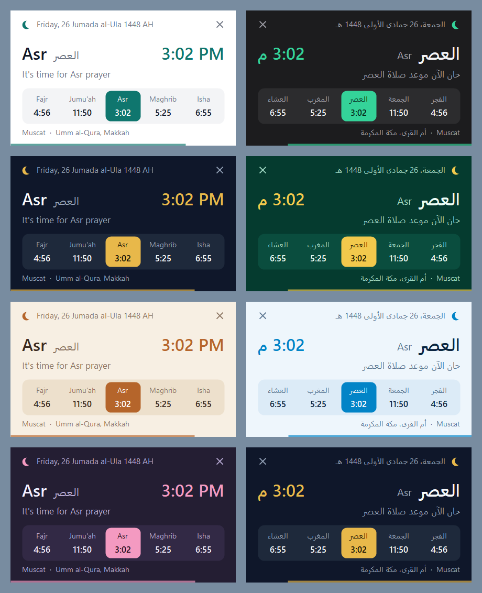

# Prayer Times Popup · أوقات الصلاة

A tiny Windows tray app that shows a clean popup in the top-right corner of your screen at each prayer time, based on your location. Available in English and Arabic.



## Download

1. Download [`PrayerTimes.exe`](https://github.com/Eng-Somar/prayer-times-popup/releases/latest/download/PrayerTimes.exe) from the [latest release](https://github.com/Eng-Somar/prayer-times-popup/releases/latest).
2. Double-click it. A crescent icon appears in the system tray (check under the **^** arrow on the taskbar).

There is no installer. The app needs Windows 10 or 11, which already include the .NET Framework it runs on.

> The exe isn't code-signed, so Windows SmartScreen may warn you the first time. Choose **More info → Run anyway**, or [build it yourself](#build-from-source).

## Features

- **Reminders:** a popup appears before each prayer (10 minutes by default) and again at the prayer time. It doesn't take focus from what you're typing.
- **Lightweight:** a 65 KB exe that uses almost no CPU. Measured when idle: about 4 MB working set and 27 MB private memory.
- **Offline calculation:** times are calculated on your PC. The internet is only used to detect your location.
- **7 designs:** Light, Dark, Midnight Gold, Emerald, Desert Sand, Ocean Breeze and Twilight, plus *Auto*, which follows the Windows light/dark setting.
- **English and العربية:** full right-to-left layout in Arabic, the Hijri (Umm al-Qura) date, and Jumu'ah shown on Fridays.

## Usage

| Action | What happens |
|---|---|
| Left-click the tray icon | Shows the next prayer |
| Right-click the tray icon | Today's times, Settings, Refresh location, Exit |
| Open the exe again while it's running | Opens Settings |
| Hover over a popup | Keeps it open |
| Click a popup | Closes it |

## Settings

- Language and design, with a **Preview** button
- Location: auto-detect, or enter your city and coordinates manually
- Calculation method: choose one, or let *Auto* pick by country (Umm al-Qura, Egyptian, UAE, Kuwait, Qatar, Jordan, Karachi, ISNA, Diyanet, Singapore, Tehran, UOIF, Russia, Muslim World League)
- Asr calculation (Standard or Hanafi) and high-latitude rule
- Reminder lead time, popup duration and 12/24-hour time
- Sound and **Start with Windows** (off by default)

**Custom adhan:** put a file named `adhan.wav` next to `PrayerTimes.exe` and it plays at prayer time. Otherwise a soft system chime plays.

Settings are stored in `%APPDATA%\PrayerTimesPopup\settings.ini`.

## Accuracy

Times are calculated astronomically, so they can differ by a few minutes from your local mosque or official timetable. Against [api.aladhan.com](https://aladhan.com/prayer-times-api) for five test cities, Fajr, Sunrise, Dhuhr, Maghrib and Isha were within a minute, while Asr came out 1–4 minutes earlier (most at high latitudes). Please follow your local authority where the two differ.

## Location and privacy

In auto-detect mode, the app sends your IP address to a public geolocation service to find your city: [ipwho.is](https://ipwho.is), with [ipapi.co](https://ipapi.co) and [ip-api.com](https://ip-api.com) (unencrypted HTTP) as fallbacks. If Windows Location is turned on, the app uses it for more precise coordinates.

Choose **Manual** in Settings to skip these lookups. Your location is only saved on your PC.

## Build from source

Run this on Windows. It uses the C# compiler included with Windows, so no SDK is needed:

```powershell
powershell -ExecutionPolicy Bypass -File build.ps1
```

The result is `dist\PrayerTimes.exe`.

## Credits and license

Prayer time calculation is a C# port of [PrayTimes.js](http://praytimes.org), Copyright (C) 2007-2017 PrayTimes.org, developed by Hamid Zarrabi-Zadeh and licensed under the GNU LGPL v3.0.

This project is licensed under the GNU LGPL v3.0: see [LICENSE](LICENSE) and [COPYING](COPYING) (the GNU GPL v3.0 text it builds on).

---

## بالعربية

تطبيق صغير لنظام ويندوز يعمل من شريط المهام، ويعرض نافذة أنيقة أعلى يمين الشاشة عند كل صلاة حسب موقعك.

**التشغيل:** حمّل [`PrayerTimes.exe`](https://github.com/Eng-Somar/prayer-times-popup/releases/latest/download/PrayerTimes.exe) ثم افتحه، وستظهر أيقونة الهلال في شريط المهام. لا يحتاج إلى تثبيت، ويعمل على ويندوز 10 و11. الملف غير موقّع رقميًا، لذلك قد يظهر تحذير من ويندوز في أول تشغيل: اختر **More info** ثم **Run anyway**.

**المزايا:**

- تذكير قبل كل صلاة (10 دقائق افتراضيًا) وعند دخول وقتها
- 7 تصاميم، إضافة إلى وضع تلقائي يتبع وضع ويندوز الفاتح أو الداكن
- واجهة عربية كاملة من اليمين إلى اليسار، مع التاريخ الهجري
- حساب الأوقات على جهازك، واستخدام الإنترنت لتحديد الموقع فقط
- إمكانية إدخال الموقع يدويًا من الإعدادات دون أي اتصال بخدمات تحديد الموقع

قد تختلف الأوقات بضع دقائق عن التقويم الرسمي في بلدك، لذا يُرجى اعتماد الجهة الرسمية المحلية عند الاختلاف.
